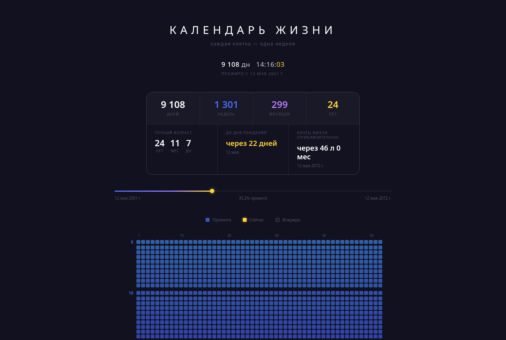

# Календарь жизни

Светлый календарь жизни для экрана и печати. Без сервера, библиотек и сборки.

## Использование

Откройте `life_calendar.html` (рядом должны находиться `styles.css`, `data.js` и `app.js`) или [сайт](https://artemius125.github.io/life-calendar/).

1. Нажмите «Персональные данные».
2. Заполните дату рождения и нужные факторы.
3. Нажмите «Рассчитать»: только теперь результат применяется и сохраняется в браузере.

Форма при загрузке свёрнута. Длинный список полей прокручивается внутри панели; кнопка «Рассчитать» закреплена снизу. Подсказка появляется один раз в этом браузере и исчезает через 8 секунд, при закрытии или открытии формы. «Сбросить» заполняет поля исходными значениями; применить их можно кнопкой «Рассчитать».

## Календарь и печать

- 52 клетки на каждый год жизни, с увеличенным промежутком после десятилетия.
- Прожитые недели заполнены, будущие пустые, текущая выделена контуром и цветом.
- Подсказки с датами доступны мышью и клавиатурой.
- Иконка принтера открывает печать браузера: выберите принтер или «Сохранить как PDF».
- Печатное оформление рассчитано на один лист A4 в книжной ориентации при масштабе 100%, без браузерных колонтитулов. Боковая панель со статистикой и прогрессом печатается рядом с календарём. Поля ввода и кнопки скрыты; клетки различаются в чёрно-белой печати.
- Последняя клетка года включает оставшиеся дни до следующего дня рождения.

## Структура

- `life_calendar.html` — разметка; `index.html` — вход для GitHub Pages.
- `styles.css` — светлая тема, адаптивная сетка, печатные стили.
- `data.js` — исходные справочники и коэффициенты.
- `app.js` — расчёты, сохранение и интерфейс.

Ввод полей не пересоздаёт сетку. При применении сетка перестраивается только при изменении даты рождения или числа лет. События клеток обрабатываются на общем контейнере.

Расчёт — ориентир, а не индивидуальный медицинский прогноз. Исходная модель и коэффициенты сохранены.
